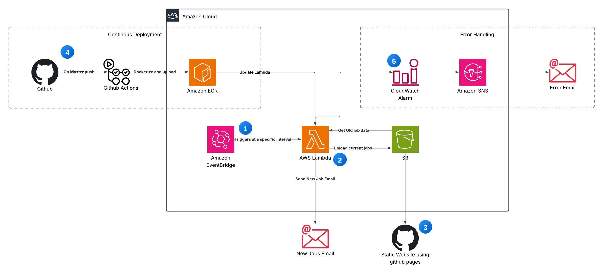

# All Seeing: Automated Job Post Alert System
This project is to help with job hunting. I was advised to try to be the first few people to apply to a new position. So I made this Python script. This script gets data from company job boards and checks if there is a new job post; if there is, then it sends an email about the new job. To make the most of this project, I recommend that you deploy this to AWS Lambda and have AWS EventBridge run this script every hour or less.

---

## Features

- **Monitors company job boards** for new postings
- **Sends email alerts** for newly listed jobs
- **Easy to extend**: Add new companies with minimal effort
- **Deployable to AWS Lambda** for automated, scheduled checks (recommended: every hour or less with AWS EventBridge)
  
## Companies Tracked

- Google
- Adobe
- Amazon
- Datadog
- Discord
- Meta
- Microsoft
- Netflix
- Nutanix
- Nvidia
- Oracle
- Palantir
- Paypal
- Walmart
- Apple
- Figma
  
---

## Quick Start

### 1. Environment Setup

- **Python Virtual Environment**
  Uses python 3.11
    ```
    python3 -m venv venv
    source venv/bin/activate  # On Windows: venv\Scripts\activate
    pip install -r requirements.txt
    ```
- **Docker (Optional)**
    - A `Dockerfile` is included for containerized deployment.


### 2. Email Notification Setup

- The script uses email to notify you about new job postings.

#### Configuration:

1. **Google App Password**
    - [Create a Google App Password](https://support.google.com/accounts/answer/185833?hl=en) for your Gmail account.

2. **`secrets.json` File**
    - Create a file named `secrets.json` in your project root:
      ```
      {
        "sender": "your_email@gmail.com",
        "password": "your_app_password"
      }
      ```

3. **Recipient Email**
    - Edit `helper/emailing.py` send_email() fucnction and set your preferred recipient email address.


### 3. Running the Project

After configuring email, run the script: ```python3 -m main```

### 4. Company Configuration (Optional)

Companies are loaded from `companies_config.json`. Each entry has an `enabled` flag:

```json
{
  "amazon": {"enabled": true},
  "meta": {"enabled": false}
}
```

- Set `"enabled": false` to temporarily disable a company without deleting its file.
- Add a new company: create the `companies/<name>.py` file and add `"<name>": {"enabled": true}` to the config.

---

## Architecture Overview



**How it Works:**

1. **Scheduled Execution:** Amazon EventBridge triggers the AWS Lambda function at regular intervals.
2. **Job Comparison & Notification:** Lambda compares the newly scraped jobs with previous data from S3 and sends email alerts if there are new jobs.
3. **Website Data:** Lambda uploads the current job data to an S3 bucket, which is used to power a static website (e.g., via GitHub Pages).
4. **Continuous Deployment:** Code changes pushed to GitHub trigger GitHub Actions, which Dockerize and deploy the application to AWS (via ECR and Lambda updates).
5. **Error Monitoring:** CloudWatch scans Lambda logs for 'ERROR'. On detection, an SNS topic sends a notification email with error details.

---

## How to Contribute

### Adding a New Company

1. **Create a Company Script**
    - In the `companies` folder, add a new file: `company_name.py`.

2. **Implement the Extractor**
    - Each script must define `extractor()`: an async function that fetches and parses job postings.
    - Diffing and persistence are handled by `helper/job_state.py`; you only write the extractor.
    - For standalone testing, include:
        ```
        if __name__ == "__main__":
            from helper import job_state
            current_jobs = asyncio.run(extractor())
            job_state.diff_and_persist(_COMPANY, current_jobs)
        ```
    - For reference, see `adobe.py`.

#### Writing the Extractor

- Most job boards use APIs to serve job data.
- **Find the API Endpoint:**
    - Open browser DevTools → Network tab.
    - Look for API calls returning job data in JSON format.
- **Convert API Call to Python:**
    - Right-click the API call → Copy as cURL.
    - Use [curlconverter.com](https://curlconverter.com/) to convert cURL to Python.
- **Extractor Return Format:**  
  Each extractor returns a **dict mapping jobId (string) to a job object**.  
  Job objects must follow the **canonical job schema** below so the website and dashboard get a consistent structure.

#### Canonical Job Schema

- **Required fields** (every job must have these):
  - `jobId` (string) – unique id for the job
  - `title` (string)
  - `url` (string) – link to the job posting
  - `detected` (string) – ISO8601 UTC timestamp, e.g. `2024-01-01T00:00:00Z`

- **Recommended optional fields:**
  - `source` (string) – company identifier, e.g. `"amazon"`, `"meta"` (set automatically if using `schemas.ensure_job()`)
  - `company` (string) – display name
  - `location` (string)
  - `posted_date`, `updated_time` (string) – when available from the API

Use `schemas.ensure_job(company_name, job_dict)` to normalize each job (sets `source`, coerces `jobId` to string).  
Example return from an extractor:

```
{
  "<jobid>": {
    "jobId": "<jobid>",
    "title": "...",
    "url": "...",
    "detected": "2024-01-01T00:00:00Z",
    "source": "amazon",
    "location": "...",
    "posted_date": "...",
    "updated_time": "..."
  },
  ...
}
```

---

## Notes

- **Debugging:** Use `if __name__ == "__main__":` in your company modules for standalone testing. Run: `python -m companies.company_name` to extract and diff locally.


